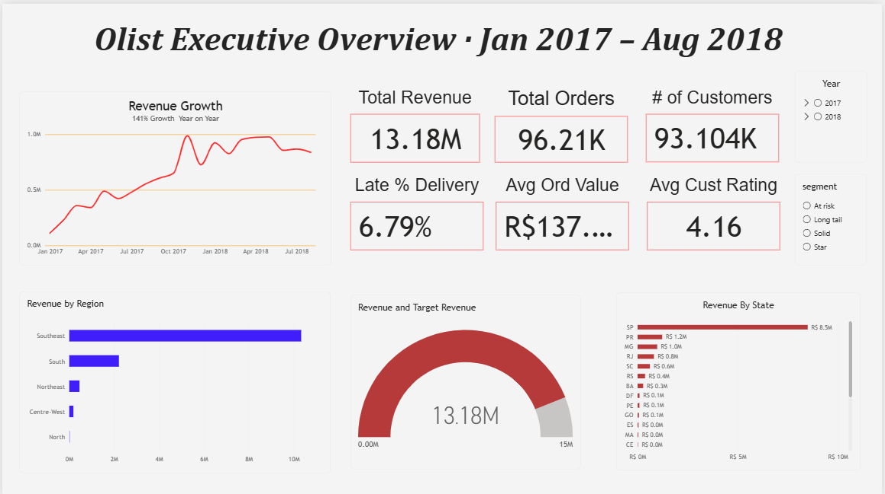

# Phase 4: Power BI dashboard

An executive overview of Olist's marketplace performance (Jan 2017 – Aug 2018), built in Power BI on top of the SQL views from Phases 1–3. Every headline figure reconciles with the SQL analysis.



## Files

| File | What it is |
|---|---|
| `olist_dashboard.pbix` | The Power BI report (open with [Power BI Desktop](https://www.microsoft.com/power-platform/products/power-bi/desktop), free) |
| `images/` | Dashboard screenshot, viewable without Power BI |
| `sql/05_powerbi_views.sql` | PostgreSQL views that shape the data for Power BI |
| `dax/measures.dax` | All DAX measures and calculated tables/columns |

## What the dashboard shows

| Visual | Purpose |
|---|---|
| KPI strip | Revenue R$13.18M · 96.21K orders · 93.1K customers · 6.79% late deliveries · R$137 average order value · 4.16 average review |
| Revenue growth (line) | Monthly revenue: +141% year on year, Black Friday 2017 peak, plateau through 2018 |
| Revenue vs target (gauge) | Revenue against a R$15M goal (88% reached) |
| Revenue by seller region and seller state (bars) | Where sales originate: sellers based in São Paulo generate 64% of revenue, while São Paulo customers account for 38%. São Paulo supplies much of the rest of Brazil, which explains higher freight costs and late deliveries in distant states |
| Slicers | Filter the whole page by year and seller segment |

## Data model

A star schema, so each metric is calculated at the right level of detail and nothing is double counted:

```
                 dim_date
                /        \
pbi_fact_sales            pbi_fact_orders
   (item grain)            (order grain)
   |         \             /
pbi_dim_seller  pbi_dim_state
```

- **pbi_fact_sales**: one row per item sold (revenue, freight, category)
- **pbi_fact_orders**: one row per delivered order (delivery time, lateness, review score)
- **pbi_dim_state**: 27 states with region and recommended strategy
- **pbi_dim_seller**: 3,068 sellers with segment (Star / Solid / At risk / Long tail) and scorecard
- **dim_date**: calendar table created in DAX

Relationships are one-to-many, single direction, from dimensions to facts.

## Key DAX measures

```DAX
Revenue          = SUM ( pbi_fact_sales[price] )
Orders           = DISTINCTCOUNT ( pbi_fact_sales[order_id] )
Avg Order Value  = DIVIDE ( [Revenue], [Orders] )
Late %           = DIVIDE ( SUM ( pbi_fact_orders[is_late] ), COUNT ( pbi_fact_orders[is_late] ) )
Avg Review       = AVERAGE ( pbi_fact_orders[review_score] )
Target Revenue   = 15000000
% of Target      = DIVIDE ( [Revenue], [Target Revenue] )
```

The full list, including year-on-year growth, Pareto (cumulative %) and seller measures, is in [`dax/measures.dax`](dax/measures.dax).

## Build notes

- **Data source:** the four `pbi_` views were exported from PostgreSQL to CSV and imported into Power BI.
- **Data types:** CSV import does not preserve types, so numeric columns (`review_score`, `is_late`, `delivery_days`) were converted to numbers in Power Query, with empty values set to null.
- **Reconciliation:** revenue (R$13,181,027) and delivered orders (96,211) match the SQL validation results.
- **Design:** one KPI row for the headline numbers, titles that state the finding, and a consistent layout for reading top-left to bottom-right.

## How to open

1. Install Power BI Desktop (free, Windows).
2. Open `olist_dashboard.pbix`. The data is stored inside the file, so no database connection is needed to view it.
3. To refresh from source, run `sql/05_powerbi_views.sql` in PostgreSQL, export the four views to CSV, and update the file paths under **Transform data → Data source settings**.

[← Back to project overview](../README.md)
