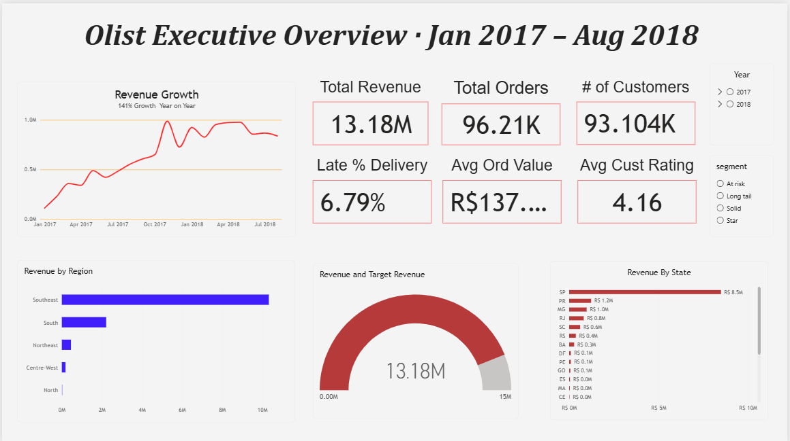

# Olist Brazilian E-commerce: Where Should a Marketplace Focus?

**SQL (PostgreSQL) case study · Google Data Analytics Professional Certificate capstone**

Olist is a Brazilian online marketplace connecting small sellers with customers in all 27 states. This project analyses ~100,000 orders (2016–2018) to find where revenue really comes from, which sellers underperform, and whether Olist should focus on key regions and categories instead of selling everything everywhere.

| Phase | Folder | What it covers |
|---|---|---|
| Raw data | [`00-raw-data`](00-raw-data) | The 8 source CSV files from Kaggle, unchanged |
| 1. ELT | [`01-sql-elt`](01-sql-elt) | Loading, cleaning and validating 8 tables (34 automated checks, 0 failures) |
| 2. EDA | [`02-sql-eda`](02-sql-eda) | Growth, seasonality, basket size, payments, delivery, reviews, retention |
| 3. Business analysis | [`03-sql-analysis`](03-sql-analysis) | States, cities, seller scorecard and segmentation, focus strategy |
| 4. Power BI dashboard | [`04-powerbi-dashboard`](04-powerbi-dashboard) | Star-schema data model, DAX measures and an interactive dashboard |
| 5. Presentation | [`05-presentation`](05-presentation) | Stakeholder deck: findings and recommendations |
| Case study report | [`06-case-study-report`](06-case-study-report) | Full write-up in Google's six phases (Ask, Prepare, Process, Analyze, Share, Act), Word and PDF |

---

## Key results at a glance

| | |
|---|---|
| **R$13.18M** revenue · 96,211 delivered orders · 93,104 customers | Jan 2017 – Aug 2018 |
| **+141%** year-on-year growth | driven by new customers; average order value flat at ~R$137 |
| **81.5%** of revenue from 7 of 27 states | São Paulo alone: 38.4% |
| **60%** of revenue from 7% of sellers | 132 "at-risk" sellers hold R$759K |
| **2.27 vs 4.29** average review, late vs on-time orders | late orders ~7x more likely to get 1–2 stars |
| **3%** of customers buy again | 90% of orders contain a single item |

---

## Ask

**Business task:** identify where Olist's revenue comes from and whether it should focus on key states, cities, sellers and categories rather than spreading effort evenly across Brazil.

**Questions**
1. Which states bring in the most revenue?
2. Which cities are the top performers?
3. Which sellers are underperforming?
4. Should Olist focus on key areas to improve revenue?

**Stakeholders:** Olist leadership (growth strategy), marketing (where to invest), seller operations (seller support and quality).

## Prepare

- **Source:** [Brazilian E-Commerce Public Dataset by Olist](https://www.kaggle.com/datasets/olistbr/brazilian-ecommerce) (Kaggle, CC BY-NC-SA 4.0). Real, anonymised company data.
- **Tables used (8):** orders, order items, payments, reviews, customers, sellers, products, category translation. The geolocation table was not needed; maps use state and city names.
- **Limitations:** no cost or margin data (profit can't be calculated); data ends in 2018; the first and last months contain very few orders.

## Process

Data was loaded into PostgreSQL untouched, then cleaned in SQL into `stg_` staging tables (ELT). Main decisions:
- Analysis window **Jan 2017 – Aug 2018** (20 complete months); revenue = item price of **delivered** orders
- Duplicate reviews removed (one per order), seller city names standardised, zip codes repaired, missing categories labelled, English category names added
- **34 validation checks:** row counts, orphans, missing values, valid ranges, payment reconciliation. All passed, with 6 known source-data issues documented.

Details: [`01-sql-elt`](01-sql-elt)

## Analyze

**Exploration** ([`02-sql-eda`](02-sql-eda)) showed fast growth from new customers but very low retention (3% repeat), single-item baskets, a Black Friday peak (5x a normal day), and a strong link between late delivery and negative reviews.

**Business analysis** ([`03-sql-analysis`](03-sql-analysis)):
- **States:** the Southeast and South generate 80% of revenue and hold 95% of sellers. The Northeast (11.3% of revenue, 1.8% of sellers) has the worst delivery (12.8% late) and the lowest reviews.
- **Cities:** the top 20 cities make 40% of revenue. Rio de Janeiro, the #2 city, grew slowest (+108% vs +141% overall) and its state has a 12.1% late rate.
- **Sellers:** a scorecard and segmentation replaced the missing profit data: 7% of sellers (Stars) = 60% of revenue; 132 at-risk sellers = R$759K; 41% of sellers stopped selling after May 2018.
- **Categories:** light, valuable categories (watches & gifts: 11.5% freight) travel well; bulky ones (office furniture: 37% freight outside the core) don't.

## Share

Findings are summarised in each phase's README and presented in an interactive Power BI dashboard ([`04-powerbi-dashboard`](04-powerbi-dashboard)) built on a star schema of SQL views, so every figure reconciles with the SQL analysis. A 14-slide stakeholder presentation ([`05-presentation`](05-presentation), PowerPoint and PDF) walks through the findings and recommendations.

## Act: recommendations

1. **Protect and grow the core** (SP, MG, South: 64.5% of revenue): prioritise Star sellers; concentrate bulky categories here.
2. **Fix delivery in Rio de Janeiro and Espírito Santo** (15.3% of revenue, 11.9% late).
3. **Develop local supply in the Northeast**, starting with Salvador, Recife and Fortaleza.
4. **Be selective in the North:** promote light, high-value categories.
5. **Support or review the 132 at-risk sellers**, starting with the highest-volume ones.
6. **A/B test more accurate delivery estimates:** reliability, not speed, drives reviews.

---

## How to reproduce

1. Use the CSV files in `00-raw-data` (or download the dataset from Kaggle) and import the 8 files into PostgreSQL as `customers`, `orders`, `order_items`, `order_payments`, `order_reviews`, `products`, `sellers`, `product_category_translation`.
2. Run, in order: `01-sql-elt/sql/00_check_raw_load.sql` → `01_build_staging.sql` → `02_validate_staging.sql` → `02-sql-eda/sql/03_eda.sql` → `03-sql-analysis/sql/04_business_analysis.sql` (each step individually).

3. To view the dashboard, open `04-powerbi-dashboard/olist_dashboard.pbix` in Power BI Desktop (data included). To rebuild its data, run `04-powerbi-dashboard/sql/05_powerbi_views.sql`.

**Tools:** PostgreSQL, pgAdmin 4, Power BI · **Skills:** data cleaning, validation, CTEs, window functions, views, segmentation, data modelling, DAX, dashboard design, business recommendations

**Author:** Mujtaba Makhdoom · [LinkedIn](https://www.linkedin.com/in/saadimakhdoom/) · [GitHub](https://github.com/saadimakhdoom)
